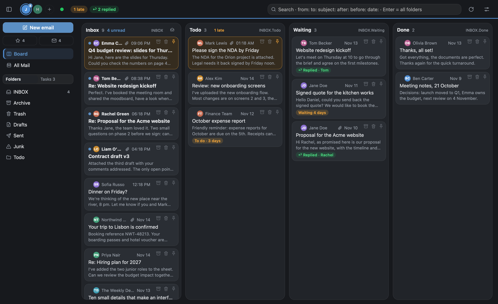
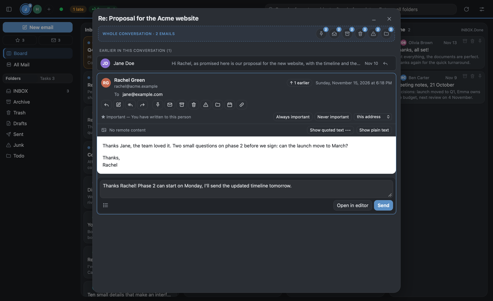
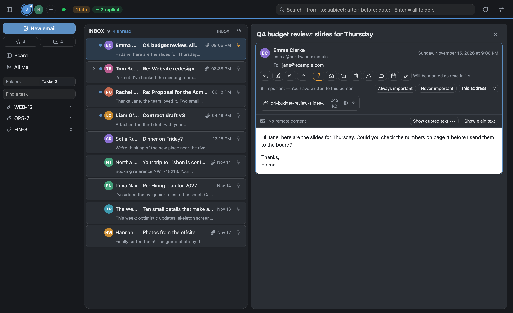
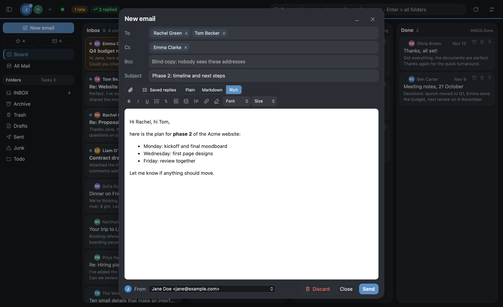
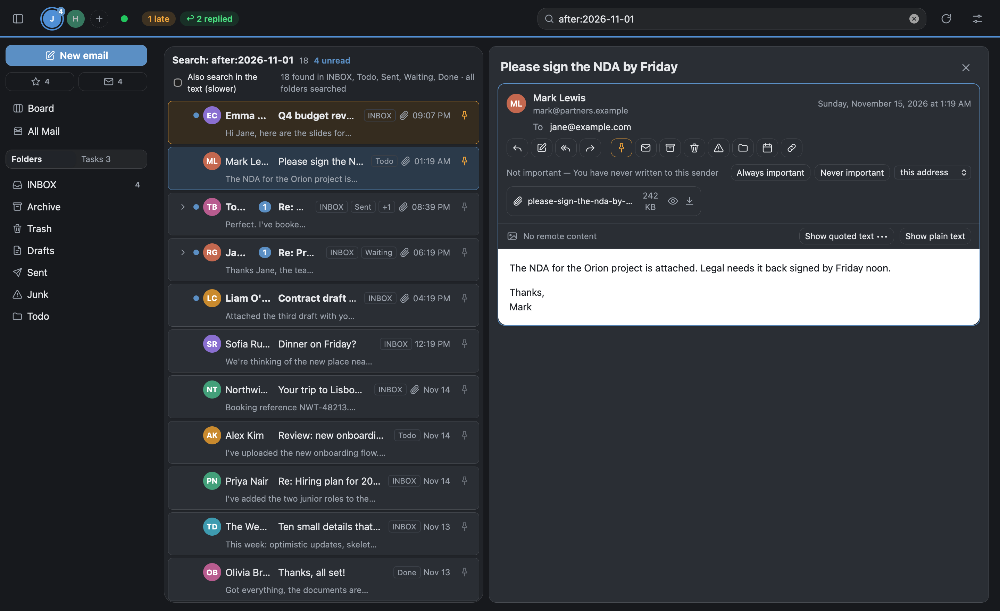

# Pigeonhole

A desktop mail app that works like a kanban board. Your folders become columns
(Inbox, Todo, Waiting, Done…), and moving an email from one column to another
really moves it on the mail server, so every other client sees the same thing.
It keeps track of what you wait on and what you still have to do, works with
several accounts and without a connection, and is quick to drive from the
keyboard.

It works with any mailbox that speaks IMAP, and signs in to iCloud, Gmail and
Microsoft 365 / Outlook.com without typing servers. Written in Rust with
[Tauri](https://tauri.app); open source under the MIT license.











<sub>Screenshots taken with fictional demo data.</sub>

## Download

- **macOS** (Apple silicon): the `.dmg` of the
  [latest release](https://github.com/Mbc-xx/Pigeonhole/releases/latest). Open
  it and drag Pigeonhole to Applications; updates replace the app and keep your
  accounts and settings.
- **Windows** (x64): the `…-setup.exe` of the newest *Windows test*
  pre-release on the [releases page](https://github.com/Mbc-xx/Pigeonhole/releases).
  It is not signed, so SmartScreen may warn: "More info" → "Run anyway".

Passwords and sign-in tokens are kept in the system's own safe store (the
macOS keychain, the Windows Credential Manager), never in a file.

Pigeonhole grew out of [KanbanMail](https://github.com/Mbc-xx/KanbanMail), the
single-account app, and carries on its full history. KanbanMail stays available
on its own; the two can run side by side with separate accounts and data.
Internal names such as the `kanbanmail-core` crate and the `KANBANMAIL_*` build
variables come from there.

## What it does

### A board for your work

- **Columns are folders.** Add, rename, reorder or remove them in Settings →
  Board; a new name creates the folder. Drag cards between columns, or onto a
  folder in the sidebar. Columns resize by dragging their edge and fill the
  window.
- **Waiting.** In the column of emails you wait on, a card shows "↩ Replied" as
  soon as an answer arrives in the conversation (click it to open the answer),
  and "Waiting N days" once it has waited longer than you chose (3 days by
  default). A reminder you send restarts the count. A notification tells you
  when an answer arrives.
- **To do.** In the Todo column a card shows "To do · N days" after the time you
  chose (5 days by default), in red after twice as long, and the column title
  counts the late ones. A conversation counts from its newest email written by
  someone else.
- **Done.** Optionally, finished emails leave the Done column after some days, to
  Archive or to a folder of yours such as "Done archive". Pinned and unread
  emails stay; Undo is offered.
- **Today**, in the top bar: late to-dos, answers arrived in Waiting and unsent
  drafts; a click takes you there.
- **Snooze** an email until later today, tomorrow, Monday morning or next week.
  It waits in a "Snoozed" folder and comes back where it was.
- **Tasks.** Link an email or a whole conversation to a task kept elsewhere
  (Jira and the like) by pasting its web link. The task shows as a tag on the
  email and on the replies that follow, and the Tasks tab beside Folders lists
  every task with its emails. The links stay on your computer.
- **Pin** emails (the IMAP `\Flagged` flag) to keep them on top.
- **Rules**: "when From / To / Subject contains … move to …", applied to new
  Inbox emails while the app runs, or to the whole Inbox on demand.

### Reading

- **Conversations.** Optionally one card per conversation, on the board and in
  folder lists. An open email shows the rest of its thread above and below it,
  also from Sent, Archive and the board columns, each row with its own quick
  actions. A bar acts on the whole conversation when you want it to.
- **Important only.** An email is important when its sender is someone you have
  written to, is in your contacts or (optionally) shares your domain;
  newsletters, mailing lists and no-reply senders are left out. "Always" and
  "Never important" fix it for an address or a domain, and the reader says why.
- **Unread** emails stand out, with counts per column and folder, an "Unread
  only" filter and a badge on the app icon.
- **Safe by default.** Remote images (and tracking pixels) are blocked until you
  allow them; links that pretend to lead somewhere else ask before opening. See
  [Reading safely](#reading-safely).
- **Attachments**: preview them without saving (Quick Look on macOS), save them
  to the folder you choose and show them in Finder, or drag them straight to a
  folder, the desktop or another app.
- **Calendar invitations** show date, time, place and organizer, with Accept /
  Maybe / Decline or "Add to Calendar".
- **Unsubscribe** from newsletters that allow it, with one click when the list
  supports it.
- **People**: click or right-click a sender or recipient to write to them, see
  their emails, copy the address, or add them to (or open them in) macOS
  Contacts.
- An opened email is marked as read after the seconds you choose, and can be
  minimized to a bar while you read others.

### Writing

- **Plain text, Markdown** (with a preview) **or Rich**, a visual editor that
  keeps pasted formatting and images; "- " or "1. " at the start of a line
  begins a list. Drafts reopen in the editor they were
  written in.
- **Recipients as chips**: drag them between To, Cc and Bcc, copy them with ⌘C,
  edit one as "Name <address>", or paste a whole list from a spreadsheet or
  Outlook. Suggestions come from your emails and the macOS address book.
- **Signatures**, one rich signature for each mailbox, and **extra senders**:
  mailboxes you only send from, each with its own SMTP server, chosen with From.
- **Quick reply**: the Quick reply button (or ⌘↓) opens a field under the open
  email; ⌘↵ sends it with signature and quote, Esc puts it away. **Saved
  replies** are written once and inserted in any email.
- **Undo send** for a few seconds (10 by default), with the email kept in Drafts
  meanwhile. Drafts are saved every 15 seconds; a reply left in Drafts is
  marked "✎ Draft reply · not sent" so it is hard to forget.
- Attachments by button or drag and drop, forwarding with attachments, Cc,
  Bcc and an optional "Always Bcc".
- The composer can be minimized to a bar while you read or copy from other
  emails. ⌘↵ sends.

### Finding

- **Search** filters the loaded cards as you type, then searches the server:
  first the main folders, then all the others, and on request the whole server
  including the text. It understands `from:`, `to:`, `subject:`, `after:`,
  `before:`, `date:` and quotes:
  `from:"Rachel Green" after:2026-10-01 invoice`.
- **All Mail** lists the 200 most recent emails of every folder, each tagged
  with its folder.
- **Sidebar**: choose which folders it shows, their order and color; the Move
  to… list has its own choice of folders and a field to find one by name. It
  folds into a rail of icons (⌘B).

### Several accounts

- A row of badges in the top bar shows every account with its unread Inbox
  emails; each has its own label, icon and color.
- Each account has its own board, signatures, rules, important senders and
  tasks. Appearance and behavior are shared, the theme too unless "Each account
  has its own theme" is on.
- The same address can be connected twice on different servers (a domain that
  signs in at Microsoft but keeps its mail elsewhere).
- Switching is quick: the connection of the account just left, and of the ones
  counted in the top bar, is kept for ten minutes, so moving to them needs no
  new login.

### Fast, also offline

- **Instant start**: the board and the folders appear at once from the copy on
  this computer, while the connection is made in the background.
- Recent emails are downloaded in the background, and pointing at an email
  starts downloading it, so the click opens it at once.
- **Without a connection** the board and downloaded emails stay readable and
  searchable; moves, archiving, read state and sending wait in a queue and are
  done in order when the server is back.
- **Live updates**: the Inbox is followed live (IDLE), the other columns are
  checked every minute. A light in the top bar shows the connection.
- **Undo** after archiving, deleting, moving or marking as spam. Optionally,
  acting on the open email opens the next one instead of the list.

### Keyboard

↑ ↓ (or J K) move between emails and ← → between columns, Enter opens; E
archives, ⌫ deletes, R / A / F reply, reply all and forward, U read or unread,
P pins, M moves (type to find the folder), Z snoozes, N writes a new email,
⌘↓ opens the quick reply, ⌘F searches. With an email open, ↑ ↓ read the
previous or next one. **?** lists them all.

### Looks

Light, dark or system theme, six colored themes and a theme of your own from
any color (every tone is worked out from it, text stays readable). Emails can be
read on a light or dark background whatever the theme. Four interface sizes,
0–2 lines of preview, compact icon-only actions.

### Opening .eml files

Pigeonhole can open `.eml` files from Finder or Explorer (Open With, or as the
default app: in Finder, Get Info → Open with → Change All). The email opens in
the reader to read, reply, forward and save its attachments; it is in no
folder, so it cannot be archived or moved.

### Notifications

New Inbox emails (all, important only, or off) and answers to emails you wait
on. On macOS, clicking a notification opens that email, and a Focus mode can
hold notifications back: add Pigeonhole to the Focus's allowed apps. Settings →
Notifications can send a test notification.

The Inbox unread counts (sidebar, account badges, Dock) can show all unread
emails or only the important ones. "Important" is one choice used everywhere:
the Important filter, notifications and counts. It means people you wrote to,
your contacts and optionally your colleagues, and optionally only emails with
you in To, not just in Cc (aliases of an account can be added).

## Mail services

The login screen knows these services, so there are no servers to type:

| Service | How it logs in | Notes |
| --- | --- | --- |
| iCloud | App-specific password, from account.apple.com | With a custom domain, also type your iCloud address |
| Gmail | App password, or Sign in with Google | App passwords need 2-Step Verification, and work accounts may not have them |
| Microsoft 365, Outlook.com | Sign in with Microsoft | The only way: Microsoft refuses passwords for IMAP |
| Any other | Server, email and password | IMAP over SSL/TLS, SMTP on 465 or 587 |

Signing in with Google or Microsoft happens in your browser: the app never sees
that password, and keeps only a token in the keychain. If the service cancels
it, the app asks you to sign in again.

On Gmail a label is a folder. All Mail and search show each email under its
labels, and under All Mail only when it has none; Starred and Important are
skipped when searching, because they hold the same emails again. Gmail saves sent
emails by itself; on iCloud and Microsoft the app saves a copy only if it is
missing.

A work mailbox can still be closed by its administrator: IMAP or Authenticated
SMTP may be off, or the app may need approval.

## Settings

From the settings button, grouped in tabs:

- **Account**: label, icon and color, sender name, SMTP server, extra send-only
  mailboxes, disconnecting the account.
- **Board**: the board columns, the Waiting, Todo and Done columns with their
  days, grouping by conversation.
- **Reading**: marking as read, undo time, what happens after an action, "only
  this email or the whole conversation", remote images.
- **Writing**: one rich signature for each mailbox, "Always Bcc", undo send
  delay, saved replies, address book suggestions.
- **Notifications**: which new emails notify and what the unread counts show,
  and what is important (colleagues of your domain, only emails with you in To,
  with the account's aliases, "always" and "never important" lists).
- **Folders**: which folders the sidebar and the Move to… list show, their order
  and colors, and the automatic rules for new Inbox emails.
- **Appearance**: theme (shared or per account), interface size, preview lines
  and compact actions, previewed while you choose.
- **Storage**: where attachments are saved, the copy on this computer, export
  and import of the settings.

They are stored as TOML files in the configuration folder
(`~/Library/Application Support/Pigeonhole` on macOS), one folder per account.
Nothing is synced to the cloud, and removing the app leaves these files in place.
"Export settings…" saves columns, signatures, rules, folders, tasks and settings
(never a password) to a JSON file; "Import settings…" applies it on another
computer.

## Copy on this computer

The local copy is a SQLite database in the cache folder
(`~/Library/Caches/Pigeonhole` on macOS), one file per account. It holds the cards
of the folders you opened, the emails you read or that were downloaded in the
background (those over 3 MB only when opened), a full-text index for search and
the changes waiting for the connection. The server always stays the reference:
the copy can be cleared from Settings → Storage and is rebuilt as you use the
app, and it is deleted when you disconnect the account. Emails are stored
unencrypted, like in other mail apps (FileVault or BitLocker encrypt the whole
disk); passwords are never stored there.

## Connections

Mail servers limit how many connections a user may open, shared with every other
client and device, so Pigeonhole uses few: one for the account in use, one that
watches the Inbox live (IDLE), one while emails are downloaded in the background,
and a short one while searching. The connections of other accounts, kept for a
quick switch, are closed after ten minutes without use.

## Reading safely

Email HTML is sanitized (no scripts, forms or links to external resources) and
shown in an isolated frame that runs no scripts and cannot load anything from
the network: remote images stay blocked until you allow them for one email or
in the settings.

Before a link of an email opens, Pigeonhole checks where it really leads. It
asks first when the text of the link names another site than its address
("www.yourbank.com" leading somewhere else), when the address hides its site
behind a name and an "@", or when the site name uses look-alike letters from
other alphabets. Hovering a link shows its full address.

Every connection (IMAP, SMTP, sign-in with Microsoft or Google) is encrypted
and checks the server's certificate against the well-known authorities: an
invalid or self-signed certificate is refused, never accepted to make things
work.

## Not supported yet

Printing. On Windows, the macOS-only parts (Contacts, Quick Look) are missing.

## Building from source

Requirements: [Rust](https://rustup.rs) (stable), Node.js (for the Tauri CLI),
and on macOS the Xcode Command Line Tools (`xcode-select --install`).

```bash
cd app
npm install
npx tauri dev      # run while developing
npx tauri build    # the installable app (.app / .dmg on macOS)
```

Layout:

```
crates/kanbanmail-core   shared logic: accounts, board, keychain, IMAP, SMTP, MIME, local copy
crates/kanbanmail-cli    command-line test tool
app/src-tauri            desktop app (Tauri backend)
app/ui                   user interface (HTML/CSS/JS, no external libraries): app.js,
                         board.js, organize.js, reader.js, compose.js, security.js,
                         settings.js, loaded in this order and sharing one scope
app/tests                tests of the interface
```

### Tests

```bash
cargo test --workspace   # Rust, including IMAP against a fake server on 127.0.0.1
cd app && npm test       # the interface, run in jsdom against a fake backend
```

The IMAP tests start a small server in memory (`crates/kanbanmail-core/src/imap/fake_server.rs`)
and check what moving, marking and loading leave on it; the interface tests load
the real `app/ui` with fake emails (`app/tests/harness.mjs`). Neither needs a
network or a real mailbox. GitHub Actions runs both, `cargo fmt --check`, clippy
and `cargo audit` on every push (`.github/workflows/ci.yml`). Format with
`cargo fmt --all` before committing.

### Browser sign-in

Sign in with Microsoft and Google needs an application id, which each build
brings its own. Without one, Sign in with Microsoft is off and Sign in with
Google is not shown. Set these when building, and do not commit them:

```bash
KANBANMAIL_MICROSOFT_CLIENT_ID=... KANBANMAIL_GOOGLE_CLIENT_ID=... KANBANMAIL_GOOGLE_CLIENT_SECRET=... npx tauri build
```

- **Microsoft:** register an application in Microsoft Entra for accounts in any
  organization and personal accounts, with a *Mobile and desktop* redirect URI
  `http://localhost`, public client flows on, and the delegated permissions
  `IMAP.AccessAsUser.All` and `SMTP.Send`.
- **Google:** create a *Desktop app* OAuth client and add the scope
  `https://mail.google.com/`. That scope is restricted: until Google verifies the
  app, it allows 100 users and sign-ins in testing mode last 7 days.

### Command-line tool

A small tool to test a server without the app. The first run asks for email,
server and password and saves them like the app does.

```bash
cargo run -p kanbanmail-cli              # log in and check the account
cargo run -p kanbanmail-cli -- board     # the board columns and their first emails
cargo run -p kanbanmail-cli -- folders   # every folder with its kind and unread count
cargo run -p kanbanmail-cli -- smtp      # test the SMTP login (sends nothing)
cargo run -p kanbanmail-cli -- drafts    # save a test draft twice, then delete it
cargo run -p kanbanmail-cli -- search some words
cargo run -p kanbanmail-cli -- known     # classify the newest Inbox emails (read-only)
cargo run -p kanbanmail-cli -- thread    # the conversation of the newest reply (read-only)
cargo run -p kanbanmail-cli -- reset     # forget the saved account and password
```

### Icons

The interface uses a small set of original line icons drawn as inline SVG
(`app/ui/index.html`), so no icon font or external file is loaded. The app icon
is drawn in `app/src-tauri/icons/icon-source.svg`; `npx tauri icon` (in `app/`)
makes every size from a 1024 px rendering of it.

## License

[MIT](LICENSE)
