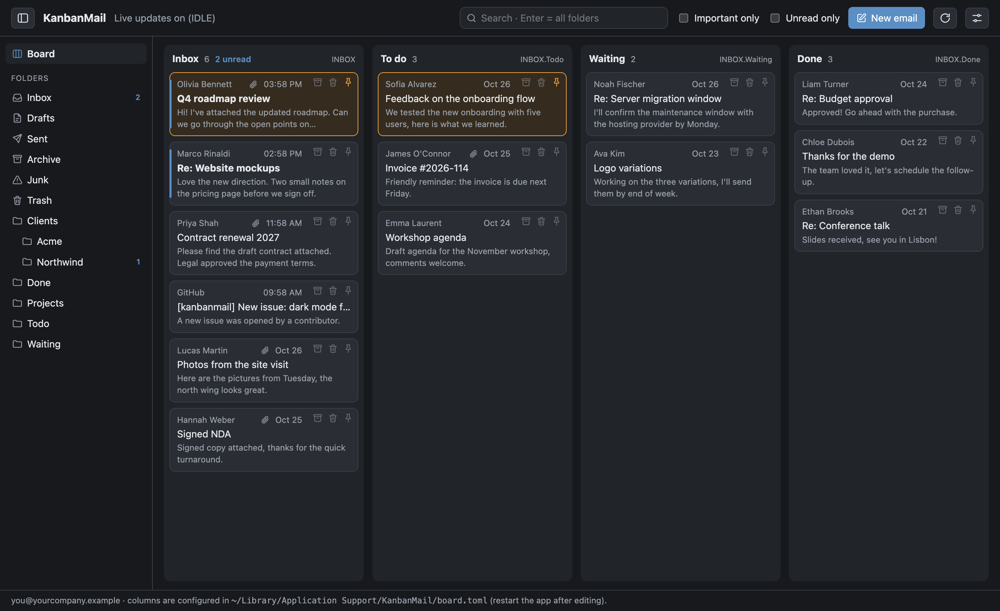
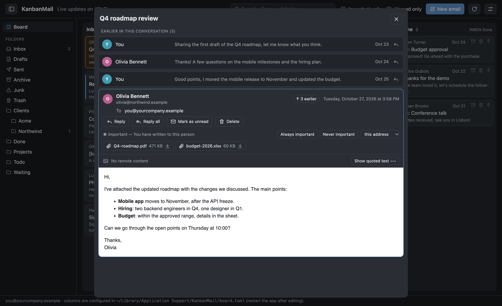

# KanbanMail

A kanban companion for your IMAP mailbox: every board column is an IMAP folder,
and dragging an email from one column to another really moves it on the server.
Written in Rust with [Tauri](https://tauri.app).

> Status: **in development**.





<sub>Screenshots taken with fictional demo data.</sub>

## Features

- First-run setup (server, email, password).
- Password stored in the operating system keychain, never in plain text.
- Columns defined in a TOML file (display name → IMAP folder); missing folders
  are created.
- Cards show sender, subject, date and a preview.
- Drag & drop between columns moves the email on the server (MOVE, or
  COPY + `\Deleted` + EXPUNGE).
- Pin via the IMAP `\Flagged` flag: 📌 icon on the card; pinned emails stay on top.
- Live updates with few connections (mail servers limit them per user, shared
  with every other client and device): the Inbox is watched live with IDLE on
  one extra connection, the other columns are checked every 60 s with a cheap
  STATUS on the main connection.
- Search: typing in the search box (Ctrl/⌘+F) filters the loaded cards at once
  (case- and accent-insensitive). Enter searches the server in sender,
  recipients and subject, in two steps: first Inbox, Sent, Archive, the board
  columns and the open folder, then every other folder (Trash, Junk and Drafts
  excluded); every word must match. Results open in a list with a reading
  pane, showing the folder of each email; "Unread only" and "Important only"
  do not hide search results. "Also search in the text" adds the
  email body, which is much slower on servers without a full-text index.
  Esc goes back to the board.
- Email reader. Remote images are blocked by default (they can reveal that you
  opened the email): load them per email with "Load images", or always from
  the settings. Inline images embedded in the email are always shown.
- Attachments listed in the reader with their size; click one to save it to
  your Downloads folder (it is then shown in Finder). Cards with attachments
  show a paperclip.
- Sidebar with every folder (Trash, Sent, Junk, subfolders…) and unread counts;
  hide it with the sidebar button or Ctrl/⌘+B. Click a folder to open it as a
  compact list with a reading pane on the right (drag the divider to resize);
  drop a card on a sidebar folder to move it there. On the board, emails open
  in a popup.
- Optional grouping by conversation (Settings → Reading): the board and the
  folder lists show one card per conversation, with its latest email, the
  people involved and how many emails it has. Archive, delete, pin and drag act
  on the whole conversation.
- "All Mail" in the sidebar: the 200 most recent emails of every folder (Trash,
  Junk and Drafts excluded) in one list, each tagged with its folder.
- Sidebar folders: choose which ones to show, drag them into your order and pick a color
  (Settings → Folders). The color also marks the board column and the folder
  tags in search results and All Mail.
- Conversations: when you open an email, the other emails of the same thread
  (found through Message-ID / References in the folder, Inbox, Sent, Archive
  and the board columns, among the most recent 2000 emails of each) appear as
  compact rows above and below it, in one scrolling column with the open
  email shown in full inside its own box. The open email stays in place when
  the earlier rows arrive; scroll up (or click "↑ N earlier") to see them.
  Click a row to open that email, or its reply button to answer it directly. Quoted earlier messages inside an email
  are hidden behind "Show quoted text".
- Quick actions on every card: 🗄 Archive, 🗑 Delete (move to Trash) and 📌 Pin.
  In narrow columns, archive/delete appear on hover.
- Resizable columns: drag the right edge (minimum 160 px); double-click the edge
  to return to automatic width.
- Unread emails highlighted (blue bar and bold), unread count per column and an
  "Unread only" filter. The number of unread Inbox emails is shown as a badge
  on the app icon in the Dock.
- "Important only" filter. An email is important when its sender is someone
  you have written to (read from your Sent folders), is in your contacts, or
  (optionally) shares your email domain. Automated emails are left out:
  mailing lists and newsletters (`List-Id`, `List-Unsubscribe`), bulk and
  automatic messages (`Precedence`, `Auto-Submitted`) and `noreply`-style
  senders. Your own rules win over everything: from an open email choose
  "Always important" or "Never important" for the address or the whole
  domain, or edit the lists in the settings. The reader shows why an email is
  (not) considered important.
- An opened email is marked as read after a configurable number of seconds
  (0 = immediately, or never); read/unread can also be toggled by hand.
- The compose area is always light, like the reader.
- Write new emails, reply ("Reply" / "Reply all") quoting the original message,
  and forward ("Forward": the original text below a header, with its
  attachments).
- Attach files with the paperclip button or by dropping them on the composer
  (up to about 25 MB in total); attachments are kept in drafts too.
- Plain text or Markdown body (bold, italic, lists, links, headings, tables and
  inline HTML), with a preview; Markdown emails are sent as text + HTML. Sending uses SMTP (port 465 SSL/TLS or 587 STARTTLS, same
  credentials as IMAP) and a copy is saved to the Sent folder.
- Cc and Bcc fields; an optional "Always Bcc" address list is added to every
  new email and reply. Bcc recipients receive the email without being visible
  to the others, and stay recorded in your copy in the Sent folder.
- Signature added to new emails and replies, with a rich editor in the
  settings (bold, italic, underline, links, images, or paste one from another
  email client; the HTML source can be edited too). When the signature has
  formatting, the email is sent as plain text + HTML, with signature images
  embedded as inline attachments. Editing the signature text inside an email
  sends that email as plain text only.
- Drafts: while writing, the email is saved to the Drafts folder every 15
  seconds (only when it changed). Closing the composer keeps the draft;
  "Discard" deletes it; sending removes it. Click a card in Drafts to keep
  writing it. Only the latest version is kept on the server.
- Address suggestions while writing: from the senders of loaded emails and,
  if enabled, from the system address book (macOS Contacts only for now;
  macOS asks for permission the first time).

## Requirements

- [Rust](https://rustup.rs) (stable)
- Node.js (for the Tauri CLI)
- macOS: Xcode Command Line Tools (`xcode-select --install`)

## Layout

```
crates/kanbanmail-core   shared logic: account, board, keychain, IMAP, SMTP, MIME parsing
crates/kanbanmail-cli    command-line test tool
app/src-tauri            desktop app (Tauri backend)
app/ui                   user interface (HTML/CSS/JS, no external libraries)
```

## Running the app

```bash
cd app
npm install
npx tauri dev
```

To build the installable app (`.app` / `.dmg` on macOS):

```bash
cd app
npx tauri build
```

## Settings

From the settings button on the board, grouped in tabs:

- **Account**: sender name, SMTP server and port, export and import of the
  settings, board columns file, disconnecting the account.
- **Writing**: signature editor, "Always Bcc", address book suggestions.
- **Reading**: seconds before an opened email is marked as read, grouping by
  conversation, remote images.
- **Important**: colleagues of your domain, "always" and "never important" lists.
- **Folders**: which folders the sidebar shows, their order and colors.

They are stored in `account.toml` and `settings.toml` in the configuration folder
(`~/Library/Application Support/KanbanMail` on macOS), next to `board.toml`. The
password is in the system keychain. Nothing is synced to iCloud; removing the app
leaves these files in place. "Export settings…" saves columns, signature, rules,
folders and settings (never the password) to a JSON file in Downloads;
"Import settings…" applies such a file on another computer (sender name and
SMTP details only if it is for the same email address).

## Configuring columns

On first run, `board.toml` is created in the configuration folder
(`~/Library/Application Support/KanbanMail` on macOS):

```toml
max_cards_per_column = 200

[[column]]
name = "Inbox"
folder = "INBOX"

[[column]]
name = "Todo"
folder = "Todo"
```

On servers that keep every folder inside `INBOX` (such as SiteGround/Dovecot),
writing `Todo` is enough: the app uses or creates `INBOX.Todo`. You can also
give the full name, e.g. `folder = "INBOX.Waiting"`. Restart the app after
editing.

## Live updates

If the server supports IDLE, the app keeps one extra connection on the Inbox
and is notified of changes right away (including those made by other clients).
The other columns are checked every 60 seconds on the main connection. In
total KanbanMail uses two connections, plus a short-lived one while searching
or reading your sent emails.

## Reading safely

Email HTML is sanitized (no scripts, forms or links to external resources) and
shown in an isolated frame that cannot load anything from the network: remote
images (and tracking pixels) stay blocked.

## Command-line tool

```bash
cargo run -p kanbanmail-cli
```

The first time it asks for email, server and password. If login succeeds, it
saves server and email to `account.toml` in the configuration folder and the
password to the keychain. Later runs connect on their own.

Show the board columns and the first emails of each:

```bash
cargo run -p kanbanmail-cli -- board
```

List every folder with its kind and unread count:

```bash
cargo run -p kanbanmail-cli -- folders
```

Test the SMTP login and find the folder that receives sent emails (sends nothing):

```bash
cargo run -p kanbanmail-cli -- smtp
```

Save a test draft twice, check that only one copy is kept, then delete it:

```bash
cargo run -p kanbanmail-cli -- drafts
```

Search sender, recipients and subject in Inbox, Sent and Archive:

```bash
cargo run -p kanbanmail-cli -- search some words
```

Count the people you wrote to and classify the newest Inbox emails (read-only):

```bash
cargo run -p kanbanmail-cli -- known
```

Show the conversation of the newest reply in the Inbox (read-only):

```bash
cargo run -p kanbanmail-cli -- thread
```

Forget the saved account and password:

```bash
cargo run -p kanbanmail-cli -- reset
```

## Not supported yet

Multiple accounts, a rich-text (WYSIWYG) editor for the email body.

## Icons

The interface uses a small set of original line icons drawn as inline SVG
(`app/ui/index.html`), so no icon font or external file is loaded.

## License

[MIT](LICENSE)
